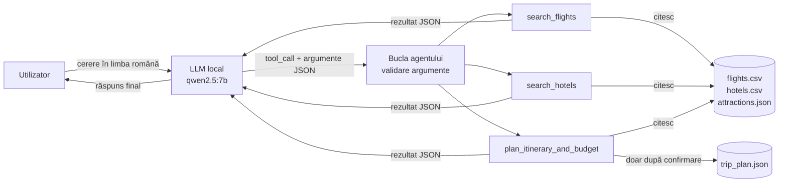

# Agent AI pentru planificarea călătoriilor (LLM local + tools)

Proiect de laborator: un agent care primește **destinația, perioada și bugetul**, folosește trei instrumente (*tools*) pentru a căuta zboruri și cazare, propune un traseu pe zile și calculează bugetul estimat. Componenta LLM rulează **local, prin [Ollama](https://ollama.com)**, cu modelul `qwen2.5:7b`.

**Autor:** Iatco Marcel

---

## Cuprins
- [Cum funcționează](#cum-funcționează)
- [Instrumentele agentului](#instrumentele-agentului)
- [Datele demonstrative](#datele-demonstrative)
- [Structura proiectului](#structura-proiectului)
- [Instalare și rulare](#instalare-și-rulare)
- [Rezultate](#rezultate)
- [Observații](#observații)
- [Limitări](#limitări)
- [Posibile îmbunătățiri](#posibile-îmbunătățiri)

---

## Cum funcționează

Un LLM singur doar generează text: nu poate citi fișiere și nu cunoaște prețuri. Agentul combină LLM-ul cu funcții Python. **Modelul decide** ce funcție să apeleze și cu ce argumente, **codul execută** funcția pe datele locale, iar modelul formulează răspunsul pe baza rezultatului.



Detalii de implementare:
- Comunicarea cu Ollama se face prin API-ul REST `/api/chat`, cu parametrul `tools` (tool calling nativ).
- **Plan de rezervă:** dacă modelul nu suportă tool calling nativ, agentul trece în modul `text`. Modelul scrie apelul ca JSON (`{"tool": ..., "arguments": {...}}`), iar codul îl extrage și îl validează.
- Argumentele primite de la model sunt verificate față de schema tool-ului: parametri obligatorii, parametri necunoscuți, format de dată `AAAA-LL-ZZ`, orașe cunoscute.
- Erorile tools sunt trimise înapoi modelului și afișate, nu ascunse.
- O verificare euristică compară sumele în EUR din răspunsul modelului cu valorile întoarse de tools.

## Instrumentele agentului

| Tool | Citește | Ce face |
|---|---|---|
| `search_flights()` | `flights.csv` | Caută zboruri după oraș de plecare, destinație, dată (opțional ±3 zile) și preț maxim. Returnează cele mai ieftine opțiuni cu locuri disponibile. |
| `search_hotels()` | `hotels.csv` | Caută hoteluri disponibile pe toată perioada, după buget pe noapte și rating minim. Calculează numărul de nopți și costul total al cazării. |
| `plan_itinerary_and_budget()` | toate trei | Alege zborul dus și întors, repartizează obiectivele turistice pe zile și calculează bugetul (zboruri, cazare, transport local, mese, obiective). Alege hotelul cu cel mai bun rating care încape în bugetul rămas. Opțional, salvează planul în `trip_plan.json`. |

Fiecare tool întoarce un dicționar cu `status`: `ok`, `fara_rezultate` (cu motivul explicat) sau `eroare`.

**Salvarea este controlată în doi pași.** Modelul trimite `save=true` doar dacă utilizatorul cere explicit salvarea. Chiar și atunci, codul cere confirmarea (`da`/`nu`) înainte de a scrie fișierul. Un plan incomplet (fără zbor sau cazare) nu se salvează. Fișierul păstrează un număr de versiune și istoricul versiunilor anterioare.

## Datele demonstrative

Datele sunt generate în notebook cu sămânță fixă (`seed=42`), deci sunt identice la fiecare rulare:

| Fișier | Conținut |
|---|---|
| `flights.csv` | 1 364 zboruri, 22 de rute între 7 orașe (București, Cluj-Napoca, Roma, Paris, Barcelona, Viena, Amsterdam), 1–31 decembrie 2026. 4 companii aeriene cu nume inventate. |
| `hotels.csv` | 42 de hoteluri (6 pe oraș), cu nume inventate, preț/noapte, rating, stele și perioadă de disponibilitate. |
| `attractions.json` | 46 de obiective turistice reale cu **costuri estimative demo**, plus cost zilnic pentru transport local și mese, pe oraș. |

Ruta Cluj-Napoca → Amsterdam lipsește intenționat, pentru a testa cazul în care nu există opțiuni.

## Structura proiectului

```
├── Agent_Planificare_Calatorii.ipynb   # tot codul și explicațiile (6 secțiuni)
├── README.md
└── date_lab/                           # creat automat la rulare
    ├── flights.csv
    ├── hotels.csv
    ├── attractions.json
    └── trip_plan.json                  # creat/actualizat doar după confirmare
```

Secțiunile notebook-ului: (1) scop și inițializare, (2) crearea și explorarea datelor, (3) implementarea și testarea separată a tools, (4) implementarea agentului, (5) demonstrație și testare, (6) concluzii.

## Instalare și rulare

**Cerințe:** Python 3.10+ (testat cu 3.12), `pandas`, `requests`, Ollama (testat cu 0.40.11).

```bash
# 1. Mediu Python (exemplu cu conda)
conda create -n lab-agent python=3.12
conda activate lab-agent
pip install pandas requests jupyter

# 2. Modelul local (~4.7 GB)
ollama pull qwen2.5:7b

# 3. Pornirea Ollama (dacă nu rulează deja aplicația), într-un terminal separat
ollama serve
```

Apoi deschide `Agent_Planificare_Calatorii.ipynb` (în PyCharm sau Jupyter) și rulează celulele **de sus în jos**.
- Celula 1.4 verifică serviciul Ollama și modelul. Dacă lipsesc, afișează instrucțiuni; după rezolvare, re-rulezi celula.
- La celula 3.5 și la testele T3 și T5 apare un câmp de text. Scrie `da` pentru a salva planul sau `nu` pentru a anula.
- Modelul se schimbă din variabila `MODEL` (secțiunea 1.2).

## Rezultate

Rulare efectivă pe Windows 11, Intel Core Ultra i7, 32 GB RAM, **fără GPU dedicat** (inferență pe CPU), Ollama 0.40.11, `qwen2.5:7b`, `temperature=0`.

### Testele directe ale tools (fără LLM)

| Test | Rezultat |
|---|---|
| Zbor București → Roma, 10.12, max 80 EUR | 2 opțiuni: 38.25 EUR (1 escală) și 66.64 EUR (direct) |
| Rută Cluj-Napoca → Amsterdam | `fara_rezultate`: „Ruta … nu există în datele demo.” |
| București → Paris, max 20 EUR | `fara_rezultate`: cel mai ieftin zbor costă 126.19 EUR |
| Oraș inexistent („Atlantida”) | eroare de validare cu lista orașelor disponibile |
| Hotel Paris, 12–15.12, max 100 EUR/noapte | 2 opțiuni, 3 nopți: 195 EUR și 300 EUR total |
| Filtrare după perioadă (Viena) | hotelul disponibil de la 16.12 este exclus pentru 10–13.12 și inclus pentru 17–19.12 |
| Plan București → Amsterdam, buget 300 EUR | plan construit, marcat „peste buget” (771.83 EUR) |
| Plan Cluj-Napoca → Amsterdam | plan „incomplet”, salvarea refuzată automat |

### Testele agentului (LLM + tools)

| Test | Cerere | Tool apelat | Status tool | Buget calculat | Timp LLM* |
|---|---|---|---|---|---|
| T1 | zbor ieftin București → Roma, max 60 EUR | `search_flights` | ok (1 opțiune, 38.25 EUR) | – | 80.4 s |
| T2 | cazare Paris 12–15.12, max 100 EUR/noapte, rating ≥ 8 | `search_hotels` | ok (1 opțiune, 195 EUR) | – | 39.4 s |
| T3 | plan București → Barcelona 10–14.12, 900 EUR, cu salvare | `plan_itinerary_and_budget` | ok, în buget | 885.95 EUR | 147.4 s |
| T4 | zbor Cluj-Napoca → Amsterdam | `search_flights` | fara_rezultate | – | 27.0 s |
| T5 | plan București → Roma 17–20.12, 700 EUR, actualizare | `plan_itinerary_and_budget` | ok, în buget | 698.93 EUR | 120.4 s |

\* Suma celor două apeluri LLM ale fiecărei cereri (decizie + răspuns final), fără timpul de introducere a confirmării. Timpul total afișat în notebook (cu confirmarea) a fost între 27.0 s și 201.4 s, cu media 94.6 s.

**Defalcarea bugetului pentru T3** (București → Barcelona, 4 nopți, buget 900 EUR):

| Zboruri | Cazare | Transport local | Mese | Obiective | **Total** | Diferență |
|---|---|---|---|---|---|---|
| 166.95 | 396.00 | 45.00 | 190.00 | 88.00 | **885.95** | +14.05 |

**Indicatori:**
- tool corect ales: **5 din 5**, toate apelurile pe calea nativă de tool calling;
- argumente valide: toate datele în format ISO, sume numerice, orașe recunoscute;
- sume din răspunsuri care nu apar în rezultatele tools: **0 din 5 teste**;
- `trip_plan.json` la final: versiunea 2 (planul Viena din testul 3.5, confirmat de două ori). La T3 și T5 salvarea a fost anulată, iar fișierul a rămas neschimbat.

## Observații

1. **Alegerea tool-ului și a argumentelor a fost corectă în toate cele 5 cereri.** Modelul a convertit datele din text („10 decembrie 2026”) în format `2026-12-10` și a extras corect bugetul și ratingul minim.
2. **Valorile numerice din răspunsuri provin din tools.** Itinerariile descrise de model la T3 și T5 corespund celor calculate de `plan_itinerary_and_budget()`.
3. **Modelul a făcut însă o afirmație falsă care nu e de tip numeric.** La T5, salvarea a fost anulată, iar tool-ul a întors explicit „Salvarea a fost anulată de utilizator”. Totuși, modelul a scris „Planul a fost actualizat și salvat în fișier”. Verificarea euristică a sumelor nu prinde astfel de erori. Statusul real trebuie citit din rezultatul tool-ului (afișat separat în notebook), nu din textul modelului. La T3, același caz a fost raportat corect.
4. **Imprecizii mai mici:**
   - la T4 modelul a spus că „nu există zboruri directe”, deși tool-ul a raportat că ruta nu există deloc în date;
   - la T1 nu a menționat că zborul de 38.25 EUR are o escală;
   - în textul generat apar greșeli de limbă română („Noapți”, „3 noapte”, „Include breakfast”).
5. **Planificatorul are limite vizibile în rezultate.** Traseul nu ține cont de ora zborurilor. La T5, „Trastevere” este programat în ziua sosirii, deși zborul dus pleacă la 19:45. „Galleria Borghese” este programată în ziua plecării, deși zborul retur pleacă la 11:30.
6. **Performanță pe CPU:**
   - fiecare cerere a necesitat 2 apeluri LLM;
   - pentru planuri, al doilea apel (răspunsul final lung) a durat 107–133 s, iar pentru căutările simple 17–27 s;
   - primul apel din sesiune (53.3 s la T1) a fost mai lent decât apelurile de decizie ulterioare (9.7–14.2 s), probabil din cauza încărcării modelului în memorie.

## Limitări

- Datele sunt fictive și acoperă doar 7 orașe și luna decembrie 2026.
- Planul presupune 1 călător, zbor dus-întors între aceleași orașe și costuri zilnice fixe pe oraș. Orele de zbor ignoră fusurile orare.
- Traseul este o repartizare simplă după prioritate și durată. Nu ține cont de ora zborurilor, de distanțe, de programul de funcționare sau de vreme.
- Calitatea textului final depinde de model. Afirmațiile despre acțiuni (de exemplu salvarea) pot fi greșite, deși datele numerice au fost corecte în testele rulate.
- Inferența pe CPU face ca un plan complet să dureze aproximativ 2 minute.

## Posibile îmbunătățiri

- Mesajul despre salvare să fie generat de cod, nu de model, pentru a elimina erori ca cea de la T5.
- Planificatorul să țină cont de ora sosirii și a plecării la repartizarea activităților.
- O verificare automată a afirmațiilor textuale importante din răspuns (status salvare, existența rutei).
- Suport pentru mai mulți călători și compararea mai multor modele locale (de exemplu `llama3.1:8b`).

---

*Linkurile către site-uri externe din acest proiect sunt strict informative. Codul nu le accesează.*
